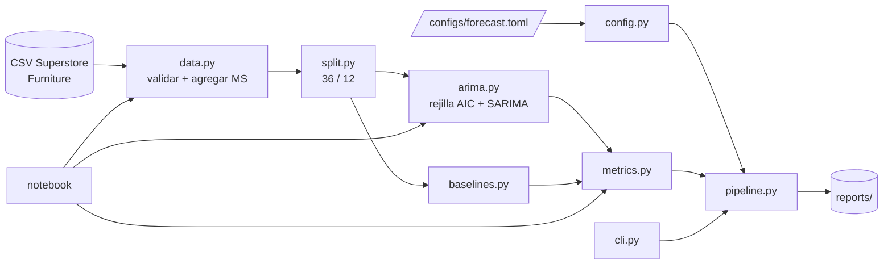

# sales-forecasting-demo

Pronóstico de **ventas mensuales** con ARIMA/SARIMA y baselines. Proyecto académico de maestría para la actividad *S1-Notebook: Modelo ARIMA para predicción de ventas mensuales* del taller **No & Low Code Tools vs AI Assisted Coding** (Mtr. Raquel Vargas, Universidad Casa Grande).

> **Origen.** Este repositorio parte de [raquelvargas16/sales-forecasting-demo](https://github.com/raquelvargas16/sales-forecasting-demo), que contiene "los archivos iniciales necesarios para seguir la demostración en vivo del uso de GitHub Copilot con Visual Studio Code". Se conserva ese propósito: el notebook de la sesión en vivo sigue siendo el centro de la entrega.

## Objetivo

Utilizar GitHub Copilot Chat para desarrollar un modelo ARIMA que pronostique una serie de ventas mensuales, evaluarlo con una partición temporal sin fuga de información y compararlo con pronósticos de referencia (*baselines*).

## Resultados (conjunto de prueba: 12 meses de 2017)

Serie mensual de 48 meses (2014-01 a 2017-12); entrenamiento de 36 meses (2014–2016) y prueba de 12 meses (2017). Orden elegido por AIC solo con el entrenamiento: **SARIMA(0, 1, 0)×(0, 1, 0, 12)**, AIC 467.64.

| Modelo | MAE | RMSE | sMAPE (%) | WAPE (%) |
|---|---|---|---|---|
| **Seasonal naive** | **3747.03** | **4473.38** | **25.70** | **20.88** |
| SARIMA(0, 1, 0)×(0, 1, 0, 12) | 12219.08 | 12939.46 | 59.20 | 68.08 |
| Moving average (3) | 11688.95 | 13105.84 | 59.59 | 65.12 |
| Naive | 18792.78 | 21085.77 | 76.79 | 104.70 |

Fuente: [`reports/metrics.json`](reports/metrics.json). Ljung-Box sobre los residuos del SARIMA: p = 0.0386 (rezago 6) y p = 0.0105 (rezago 12).

**Lectura honesta:** el SARIMA de la sesión en vivo **no supera** al *seasonal naive*, y sus residuos conservan autocorrelación. La explicación y las limitaciones están en [`docs/04-metodologia-pronostico.md`](docs/04-metodologia-pronostico.md).

## Arquitectura (resumen)



- `src/sales_forecasting/`: paquete con la lógica reutilizable y probada.
- `notebooks/ventas_mensuales_live_coding.ipynb`: narrativa de la sesión en vivo; importa el paquete.
- `src/modeling/arima_trainer.py`: contrato original del taller (`select_arima_order`), reexportado desde el paquete.
- `h2o_demo/`: demo **opcional** de H2O AutoML (Low-Code), fuera del núcleo.

Detalle y decisiones (ADR) en [`docs/02-arquitectura.md`](docs/02-arquitectura.md).

## Requisitos

| Requisito | Versión | Notas |
|---|---|---|
| Python | **>= 3.13** | Verificado con 3.13.16 |
| Dependencias | fijadas en `requirements.txt` / `pyproject.toml` | pandas 3.0.3, numpy 2.4.6, statsmodels 0.14.6, matplotlib 3.11.2, scikit-learn 1.9.0, ipykernel 7.3.0 |
| Java (OpenJDK) | Solo para la demo opcional de H2O | H2O 3.46.0.12 arrancó con **OpenJDK 21** ([evidencia](reports/evidence/h2o_smoke.txt)). No hace falta Java 27, como indicaba el README original. |
| VS Code + GitHub Copilot Chat | — | Para la práctica del taller |

## Instalación

**Linux / macOS**

```bash
git clone https://github.com/Alexis-VsCode/sales-forecasting-demo.git
cd sales-forecasting-demo
python3.13 -m venv .venv
source .venv/bin/activate
pip install -r requirements.txt
pip install -e ".[dev]"
```

**Windows PowerShell**

```powershell
git clone https://github.com/Alexis-VsCode/sales-forecasting-demo.git
cd sales-forecasting-demo
py -3.13 -m venv .venv
.\.venv\Scripts\Activate.ps1
python -m pip install -r requirements.txt
python -m pip install -e ".[dev]"
```

Solo el núcleo, sin H2O: `pip install -e ".[dev]"`. Para añadir H2O: `pip install -e ".[h2o]"`.

## Ejecución

```bash
# Pipeline completo: datos -> agregación mensual -> split -> SARIMA + baselines -> métricas y figuras
python -m sales_forecasting --config configs/forecast.toml

# Sin sobrescribir reports/
python -m sales_forecasting --config configs/forecast.toml --output-dir salida-local
```

**Notebook:** abrir `notebooks/ventas_mensuales_live_coding.ipynb` en VS Code, elegir el kernel `.venv` y ejecutar *Run All*; o bien:

```bash
jupyter nbconvert --to notebook --execute --inplace --ExecutePreprocessor.timeout=600 notebooks/ventas_mensuales_live_coding.ipynb
```

La versión compilada para la entrega (PDF, HTML y ZIP) está en [`entrega/`](entrega/README_ENTREGA.md).

## Pruebas y calidad

```bash
pytest                          # unitarias + integración
pytest -m "not integration"     # solo unitarias
ruff check src tests
ruff format --check src tests
```

La CI de GitHub Actions ([`.github/workflows/ci.yml`](.github/workflows/ci.yml)) ejecuta lint, formato, pruebas, el pipeline y el notebook. Una prueba de integración comprueba que el código actual regenera las cifras de `reports/metrics.json`.

## Estructura

```text
.
├── configs/forecast.toml          # parámetros del pipeline (sin secretos)
├── docs/                          # documentación académica y técnica
├── entrega/                       # notebook compilado (PDF/HTML/ZIP)
├── h2o_demo/                      # demo opcional de H2O AutoML
├── notebooks/                     # notebook de la sesión en vivo
├── reports/                       # métricas, pronósticos, figuras y evidencias
├── src/
│   ├── data/stores_sales_forecasting.csv   # datos originales (no se modifican)
│   ├── modeling/arima_trainer.py           # contrato original del taller
│   └── sales_forecasting/                  # paquete principal
├── tests/                         # pruebas unitarias e integración
├── pyproject.toml
├── requirements.txt
└── requirements-dev.txt
```

## Solución de problemas

| Problema | Solución |
|---|---|
| PowerShell no permite activar `.venv` | `Set-ExecutionPolicy -Scope CurrentUser -ExecutionPolicy RemoteSigned` |
| `UnicodeDecodeError` al leer el CSV | El archivo es latin-1: usar `encoding="latin-1"` (ya lo hace `load_sales_csv`). |
| `FileNotFoundError` con `../../src/data/` | Ruta del template original; el notebook actual la resuelve desde la raíz del repo. |
| `ModuleNotFoundError: matplotlib` | `pip install -r requirements.txt` (ya incluye matplotlib). |
| VS Code no encuentra el kernel | `pip install ipykernel` y seleccionar el intérprete `.venv`. |
| H2O no arranca | Instalar Java (verificado con OpenJDK 21) y comprobar `java -version`. Solo afecta a `h2o_demo/`. |

Más casos en [`docs/03-manual-instalacion-ejecucion.md`](docs/03-manual-instalacion-ejecucion.md).

## Documentación

| Documento | Contenido |
|---|---|
| [00 — Fuentes y alcance](docs/00-fuentes-y-alcance.md) | Fuentes revisadas y no revisadas, consigna, pendientes |
| [01 — Inventario técnico](docs/01-inventario-tecnico.md) | Inventario, diagnóstico, hallazgos, riesgos |
| [02 — Arquitectura](docs/02-arquitectura.md) | Diagramas Mermaid y ADR |
| [03 — Manual de instalación y ejecución](docs/03-manual-instalacion-ejecucion.md) | Paso a paso (Windows y Linux/macOS) |
| [04 — Metodología de pronóstico](docs/04-metodologia-pronostico.md) | Datos, split, baselines, métricas, resultados |
| [05 — Validaciones y evidencias](docs/05-validaciones-evidencias.md) | Comandos y salidas reales |
| [06 — Guía de presentación](docs/06-guia-presentacion.md) | Guion de demo y preguntas probables |
| [07 — Trazabilidad de requisitos](docs/07-trazabilidad-requisitos.md) | Requisito → archivo → evidencia → estado |
| [08 — Informe final](docs/08-informe-final.md) | Informe académico listo para PDF |

## Uso de IA

El notebook se desarrolló con GitHub Copilot Chat en la sesión en vivo, y la versión final se revisó con un asistente de código de IA. Todas las cifras provienen de ejecutar el código; ver la sección 6 de [`docs/08-informe-final.md`](docs/08-informe-final.md).

## Origen, atribución y licencia

- Repositorio original y material del taller: **Raquel Vargas** — https://github.com/raquelvargas16/sales-forecasting-demo (notebook template, demo de H2O, dataset y presentación `No & Low Code Tools vs Al Assisted Coding.pdf`).
- El repositorio original **no incluye un archivo de licencia**. Sin licencia explícita, los derechos quedan reservados a su autora: este trabajo se usa con fines **académicos** dentro del taller. Para redistribuirlo o reutilizarlo fuera de ese contexto, solicite permiso a la autora.
- Datos: subconjunto *Furniture* del conjunto de demostración público *Superstore*; se usa sin modificaciones.
