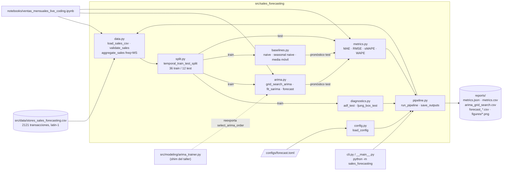
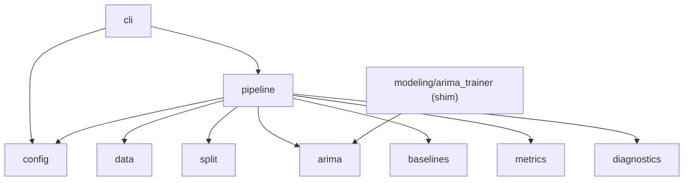

# 02 — Arquitectura

## 1. Visión general

El proyecto separa en dos piezas lo que el template original mezclaba en un notebook:

1. **Paquete `sales_forecasting`** (`src/sales_forecasting/`): la lógica reutilizable y probada (ingesta, validación, agregación, partición temporal, baselines, métricas, diagnósticos, ARIMA y pipeline).
2. **Notebook** (`notebooks/ventas_mensuales_live_coding.ipynb`): la narrativa de la sesión en vivo (exploración, gráficos e interpretación), que importa funciones del paquete en lugar de duplicarlas.

La demo de H2O AutoML (`h2o_demo/`) se mantiene como material **opcional** del taller y no forma parte del núcleo.

## 2. Flujo de datos

### Dependencias entre módulos

Los módulos de dominio (`data`, `split`, `baselines`, `metrics`, `diagnostics`, `arima`) no dependen entre sí; solo `pipeline` los orquesta. Esto permite probarlos de forma aislada con datos sintéticos.

## 3. Descripción de los módulos

| Módulo | Responsabilidad | API principal |
|---|---|---|
| `config.py` | Configuración inmutable y validada; lectura de TOML con `tomllib`; rutas relativas resueltas contra la raíz del repo. | `ForecastConfig`, `load_config(path)` |
| `data.py` | Lee el CSV (latin-1), valida columnas, fechas (`%m/%d/%Y`), ventas numéricas y no negativas; agrega por periodo con índice regular. | `load_sales_csv`, `validate_sales`, `aggregate_sales(df, date_column, target_column, freq='MS')`, `DataValidationError` |
| `split.py` | Partición temporal sin barajar; comprueba orden cronológico y que `train` termine antes de `test`. | `temporal_train_test_split(series, test_size)` |
| `baselines.py` | Pronósticos de referencia. | `naive_forecast`, `seasonal_naive_forecast(train, h, season_length)`, `moving_average_forecast(train, h, window)` |
| `metrics.py` | Métricas de error. | `mae`, `rmse`, `smape`, `wape`, `mape`, `evaluate_forecast` |
| `diagnostics.py` | Pruebas estadísticas. | `adf_test(series, alpha) -> dict`, `ljung_box_test(resid, lags) -> DataFrame` |
| `arima.py` | Ajuste SARIMA (statsmodels), búsqueda en rejilla por AIC y pronóstico con intervalo. | `fit_sarima`, `grid_search_arima`, `select_arima_order`, `forecast(results, h, alpha)` |
| `pipeline.py` | Caso de uso de extremo a extremo y persistencia de resultados y figuras. | `run_pipeline(config) -> PipelineResult`, `save_outputs(result, config)` |
| `cli.py` / `__main__.py` | Interfaz de línea de comandos. | `python -m sales_forecasting --config configs/forecast.toml [--output-dir DIR] [-v]`; script `sales-forecast` |
| `src/modeling/arima_trainer.py` | Compatibilidad con el contrato del taller. | `select_arima_order` (reexportada) |

## 4. Decisiones de arquitectura (ADR)

### ADR-001 — Paquete *src-layout* pragmático, sin capas vacías
- **Contexto:** las instrucciones del proyecto sugieren capas `domain/`, `application/`, `infrastructure/` e `interfaces/`, pero piden "no imponer capas vacías".
- **Decisión:** un único paquete plano `src/sales_forecasting/` con un módulo por responsabilidad. `pipeline.py` cumple el papel de caso de uso y `cli.py` el de interfaz.
- **Consecuencias:** menos indirección para un proyecto de unas pocas centenas de líneas; fácil de defender en clase. Si el proyecto crece (más modelos, API), se puede dividir en capas sin romper la API pública.

### ADR-002 — Agregación mensual con `freq='MS'`
- **Contexto:** el template agregaba por semana (`'W'`), pero la consigna pide ventas **mensuales** y el modelo usa estacionalidad `s = 12`.
- **Decisión:** `aggregate_sales(..., freq='MS')` (inicio de mes) con `asfreq` para garantizar un índice regular; los meses sin transacciones quedarían en 0 (en este dataset no hay ninguno).
- **Consecuencias:** 48 observaciones (2014-01 a 2017-12); `s = 12` representa un año. Se conserva la opción `freq="W"` en `h2o_demo` para reproducir el comportamiento original.

### ADR-003 — Selección del orden por AIC solo con entrenamiento
- **Contexto:** elegir el modelo mirando el conjunto de prueba es una fuga de información.
- **Decisión:** `grid_search_arima` se ejecuta sobre `train` (36 meses); el conjunto de prueba (12 meses de 2017) se usa una sola vez para evaluar. El pronóstico futuro reentrena con toda la historia **conservando** el orden ya elegido.
- **Consecuencias:** métricas de prueba honestas; una prueba de integración comprueba que no hay solapamiento temporal.

### ADR-004 — Baselines obligatorios
- **Contexto:** un modelo de pronóstico solo aporta valor si supera a referencias simples.
- **Decisión:** se evalúan siempre *naive*, *seasonal naive* (s = 12) y media móvil (ventana 3) con las mismas métricas y el mismo horizonte que el SARIMA.
- **Consecuencias:** permitió detectar que el SARIMA de la sesión **no supera** al *seasonal naive* (ver `docs/04-metodologia-pronostico.md`).

### ADR-005 — H2O como componente opcional, fuera del núcleo
- **Contexto:** H2O requiere Java, arranca un servidor local y su demo usa una partición aleatoria; la consigna S1 se centra en ARIMA con Copilot.
- **Decisión:** `h2o` queda como extra opcional (`pip install -e ".[h2o]"`), no está en las dependencias base de `pyproject.toml` y el pipeline no lo importa. Se corrigieron sus rutas y su frecuencia, y se añadió una prueba de humo (`h2o_demo/smoke_h2o.py`).
- **Consecuencias:** el núcleo se instala y prueba sin Java. Arranque verificado con OpenJDK 21 (`reports/evidence/h2o_smoke.txt`). Nota: `requirements.txt` conserva `h2o==3.46.0.12` por compatibilidad con el README original del taller.

### ADR-006 — Configuración TOML con `tomllib`
- **Contexto:** hacían falta parámetros externos sin añadir dependencias.
- **Decisión:** `configs/forecast.toml` leído con `tomllib` (biblioteca estándar desde Python 3.11). `ForecastConfig` es un `dataclass` inmutable que valida sus valores en `__post_init__`.
- **Consecuencias:** cero dependencias nuevas; la configuración no contiene secretos y se puede versionar.

### ADR-007 — Shim `src/modeling/arima_trainer.py`
- **Contexto:** el taller definió el contrato `select_arima_order(series, p_values, d_values, q_values, seasonal_order) -> ((p, d, q), aic)` en ese archivo, con el cuerpo vacío.
- **Decisión:** implementar la función en `sales_forecasting.arima` y dejar en el archivo original una reexportación (con un *fallback* a `sys.path` si el paquete no está instalado).
- **Consecuencias:** se conserva la ruta de importación que conocen la docente y los compañeros, sin duplicar lógica.

## 5. Calidad y reproducibilidad

- **Pruebas:** `tests/` (unitarias con datos sintéticos e integración con el CSV real, marcadas con `@pytest.mark.integration`).
- **Lint y formato:** `ruff` (configurado en `pyproject.toml`; excluye `notebooks` y `h2o_demo`).
- **CI:** `.github/workflows/ci.yml` (lint, formato, pytest, pipeline y ejecución del notebook con nbconvert).
- **Semilla:** `seed = 42` en la configuración (ARIMA es determinista; se fija por reproducibilidad general).
- **Versiones registradas:** `reports/metrics.json` → `environment`.
